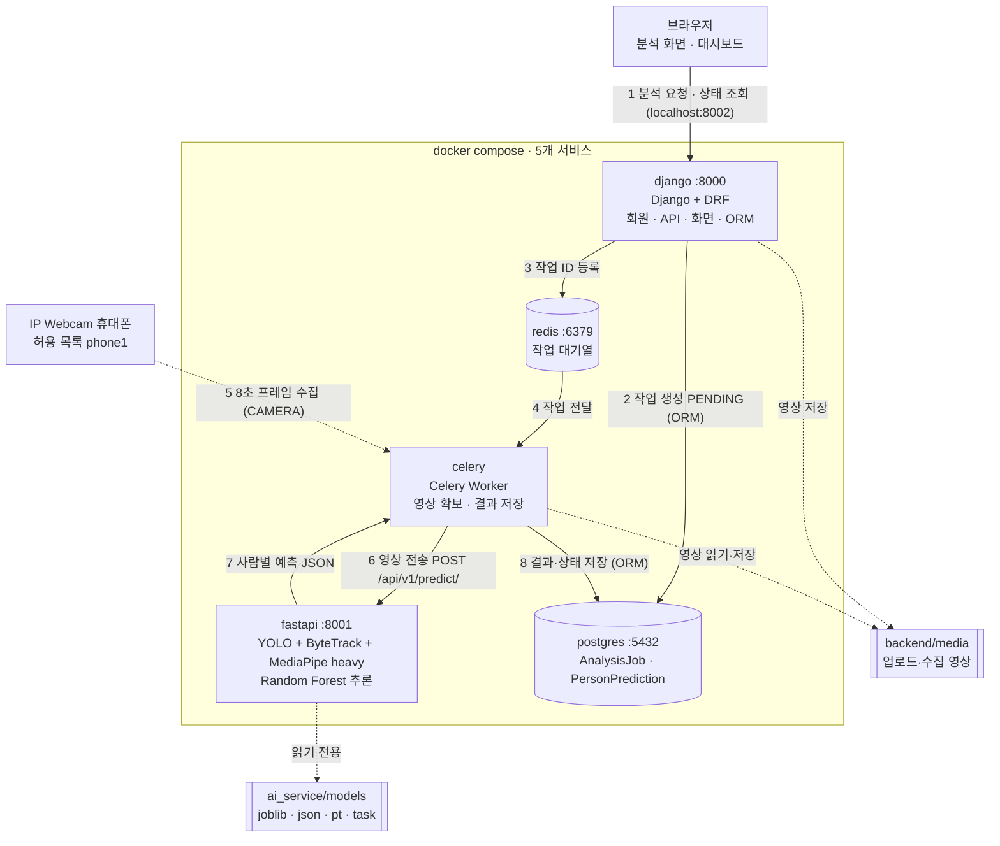
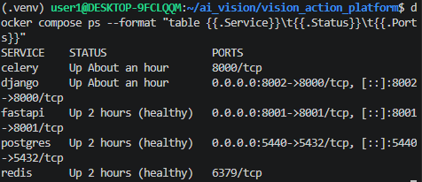
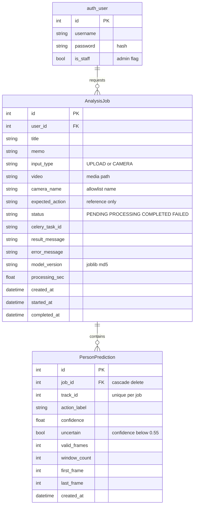
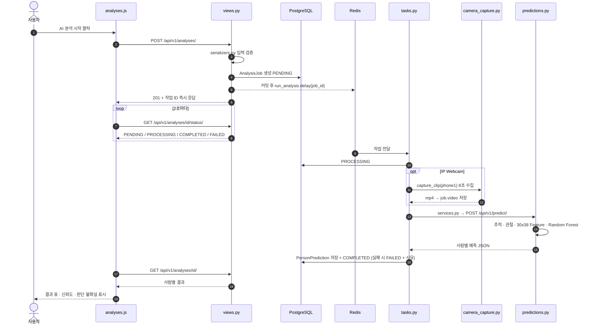
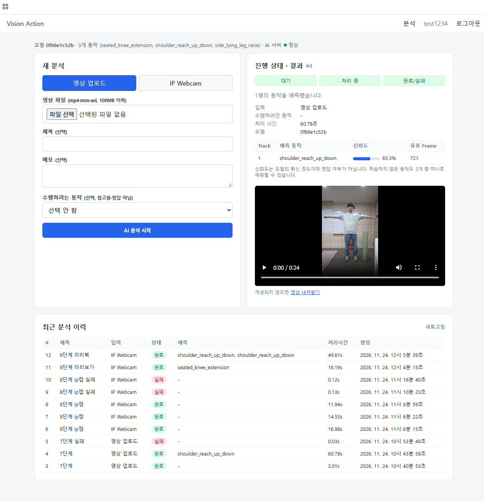
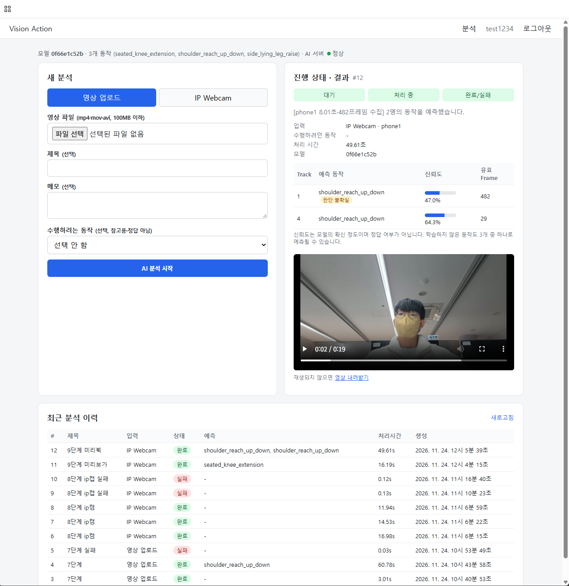
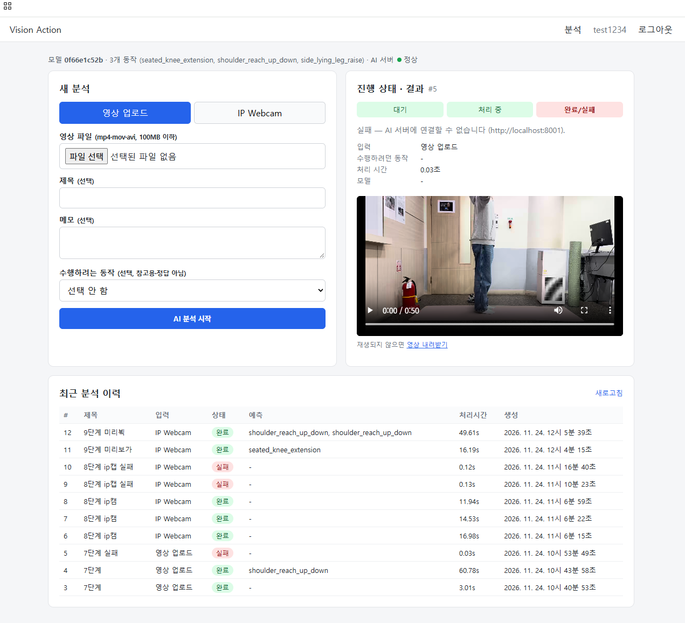
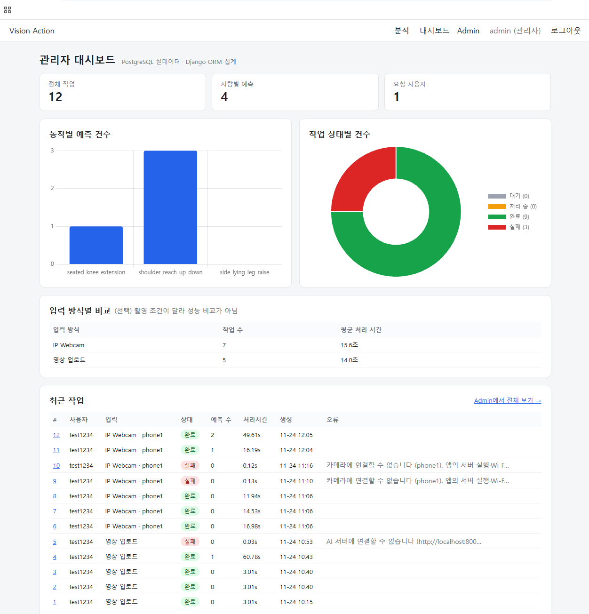
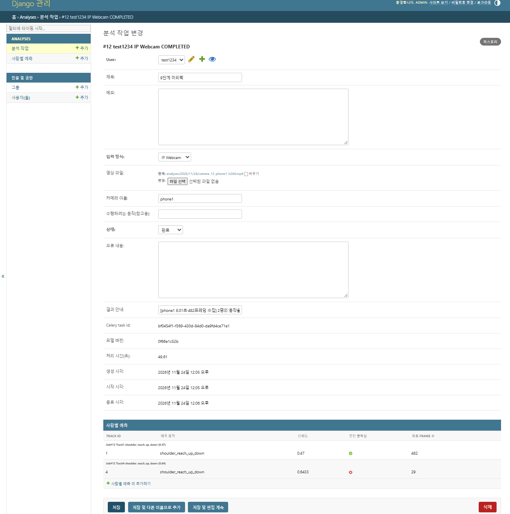
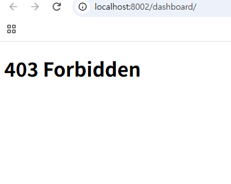

# Vision Action Platform

> 학습된 동작 인식 모델(Random Forest)을 재사용해, 브라우저에서 **영상 업로드** 또는 **IP Webcam**으로 AI 분석을 요청하고
> 결과를 **PostgreSQL에 저장·조회**하며, 관리자가 **대시보드**로 전체 기록을 확인하는 Vision AI 웹 서비스

## 목차
1. [프로젝트 소개](#1-프로젝트-소개)
2. [실행 방법](#2-실행-방법)
3. [전체 아키텍처](#3-전체-아키텍처)
4. [DB 설계 (ERD)](#4-db-설계-erd)
5. [AI 분석 버튼 구현 흐름](#5-ai-분석-버튼-구현-흐름)
6. [사용한 모델과 입력 형식](#6-사용한-모델과-입력-형식)
7. [실행 결과와 검증](#7-실행-결과와-검증)
8. [문제 해결 기록](#8-문제-해결-기록)
9. [프로젝트 구조](#9-프로젝트-구조)

---

## 1. 프로젝트 소개

사용자가 운동 동작 영상을 올리거나 휴대폰 카메라(IP Webcam) 앞에서 8초간 동작하면, 영상 속 **사람마다 어떤 동작을 했는지** 예측해 보여 주는 서비스입니다.
이전 실습에서 학습한 Random Forest 모델을 **다시 학습하지 않고** 그대로 사용하며, 학습 때와 같은 방식(사람 추적 → 관절 추출 → 30 Step × 38 Feature)으로 입력을 만들어 추론합니다.

| 지원 입력 | 내용 |
|---|---|
| 영상 업로드 | mp4·mov·avi, 100MB 이하 |
| IP Webcam | 허용된 카메라에서 **8초** 수집 후 분석 (실시간 미리보기 제공) |

| 사용자가 보는 결과 | 관리자가 보는 결과 |
|---|---|
| 작업 상태(대기·처리 중·완료·실패), 사람(Track ID)별 예측 동작·신뢰도·판단 불확실 표시, 분석 영상, 최근 이력 | 동작별 예측 건수·상태별 작업 건수 차트, 최근 작업 목록, Django Admin |

**기술 스택**: Django 5.2 · DRF · Celery · Redis · PostgreSQL 16 · FastAPI · Ultralytics YOLO11 · ByteTrack · MediaPipe Pose heavy · scikit-learn · Docker Compose

---

## 2. 실행 방법

### 사전 준비
- Docker Desktop (WSL 2 연동)
- 학습 산출물 — **용량 문제로 Git에 포함하지 않음.** `ai_service/models/`에 아래 파일을 넣습니다.

| 파일 | 설명 | 받는 곳 |
|---|---|---|
| `rf_action_baseline.joblib` | 학습 완료 Random Forest (팀 모델 `rf_action_team.joblib`을 이 이름으로) | 팀 학습 저장소 `artifacts/team/` |
| `rf_feature_columns.json` | 1,140개 Feature 이름·순서 | 〃 (Git 포함) |
| `rf_training_info.json` | 클래스·Sequence 길이 등 학습 정보 | 〃 (Git 포함) |
| `yolo11n-pose.pt` | 사람 박스·추적용 YOLO Pose | 없으면 Ultralytics 자동 다운로드 |
| `pose_landmarker_heavy.task` | 관절 추출용 MediaPipe heavy | [MediaPipe 공식](https://storage.googleapis.com/mediapipe-models/pose_landmarker/pose_landmarker_heavy/float16/latest/pose_landmarker_heavy.task) |

학습 저장소가 있다면 한 번에 가져올 수 있습니다.
```bash
bash scripts/sync_from_training.sh <학습저장소 경로> team
```

### 실행
```bash
# 1) 환경 변수
cp .env.example .env          # 비밀번호·카메라 주소 등을 실제 값으로 수정

# 2) PostgreSQL 데이터 볼륨 (처음 한 번)
docker volume create vap_pgdata

# 3) 빌드 + 실행 (처음 빌드는 5~15분)
docker compose up --build -d
docker compose ps             # 5개 서비스 Up, postgres·redis·fastapi healthy

# 4) 관리자 계정 (마이그레이션은 django 컨테이너 시작 시 자동 실행)
docker compose exec django python manage.py createsuperuser
```

| 화면 | 주소 |
|---|---|
| 사용자 분석 화면 | http://localhost:8002/analyses/ |
| 회원가입 / 로그인 | http://localhost:8002/accounts/signup/ · /accounts/login/ |
| 관리자 대시보드 (`is_staff`) | http://localhost:8002/dashboard/ |
| Django Admin | http://localhost:8002/admin/ |
| 분석 API (DRF) | http://localhost:8002/api/v1/analyses/ |
| FastAPI 문서 (개발 확인용) | http://localhost:8001/docs |

> PC의 8000번 포트를 다른 프로젝트가 사용 중이라 Django를 **8002**로 연결했습니다 (컨테이너 내부는 8000).

### 자주 쓰는 명령
```bash
docker compose logs -f celery fastapi      # 분석 흐름 로그
docker compose up -d --build               # 코드 수정 후 반영
docker compose down                        # 종료 (DB 볼륨·media 유지)
docker compose exec django python manage.py test analyses accounts   # 테스트 16개
```

### 환경 변수 (`.env.example`)
| 변수 | 설명 |
|---|---|
| `DJANGO_SECRET_KEY`, `DJANGO_DEBUG`, `DJANGO_ALLOWED_HOSTS` | Django 기본 설정 |
| `POSTGRES_DB`, `POSTGRES_USER`, `POSTGRES_PASSWORD` | DB 접속 정보 (Compose가 컨테이너 주소로 덮어씀) |
| `CAMERA_ALLOWLIST` | `이름=주소` 형식의 허용 카메라 목록 (예: `phone1=http://<휴대폰IP>:8080/video`) |
| `CAMERA_CAPTURE_SECONDS` | IP Webcam 수집 시간 (기본 8초) |
| `MAX_UPLOAD_MB` | 업로드 최대 크기 (기본 100) |

---

## 3. 전체 아키텍처





### 서비스 역할

| 서비스 | 실행 프로그램 | 맡은 일 | 하지 않는 일 |
|---|---|---|---|
| `django` | Django + DRF (`backend/`) | 회원·권한, 분석 요청 API, 사용자 화면, 관리자 대시보드, ORM | AI 추론, 모델 학습 |
| `celery` | Celery Worker (`backend/`와 같은 이미지) | 작업을 꺼내 영상 확보 → FastAPI 호출 → 결과를 ORM으로 저장 | 화면 렌더링 |
| `redis` | Redis 7 | Celery 작업 대기열(브로커) | 업무 데이터 영구 저장 |
| `fastapi` | FastAPI (`ai_service/`) | 영상 → 사람 추적·관절 추출 → 1,140 Feature → Random Forest → 사람별 JSON | DB 접근, 회원 관리 |
| `postgres` | PostgreSQL 16 | 사용자·분석 작업·사람별 예측 영구 저장 | – |

### 설계 결정
- **추론과 저장 분리** — FastAPI는 결과 JSON만 반환하고, 저장은 Celery가 Django ORM으로 합니다. PostgreSQL에 접근하는 코드가 Django 한 곳에만 있어 테이블 정의가 하나로 유지됩니다.
- **비동기 처리** — 추론에 수십 초가 걸리므로 Django는 작업 ID만 **즉시** 반환하고, 무거운 처리는 Worker가 맡습니다. 작업 등록은 `transaction.on_commit`으로 **DB 저장이 끝난 뒤** 실행합니다.
- **서비스 이름으로 통신** — 컨테이너끼리는 `postgres:5432`, `redis:6379`, `http://fastapi:8001`을 사용합니다 (`localhost` 사용 안 함).
- **영상 전달** — Celery가 FastAPI에 영상 파일을 HTTP(multipart)로 업로드합니다. 업로드·수집 영상은 `backend/media`를 `django`·`celery`가 함께 사용합니다.
- **카메라 보안** — 사용자는 카메라 **이름**(`phone1`)만 고르고, 실제 주소는 서버 `.env` 허용 목록에만 있습니다. 미리보기도 Django가 중계해 주소가 브라우저에 노출되지 않습니다.
- **모델 파일** — 용량이 큰 모델은 Git·이미지에 넣지 않고 `ai_service/models`를 읽기 전용으로 연결합니다.
- **데이터 유지** — PostgreSQL 데이터는 Docker 볼륨 `vap_pgdata`에 저장되어 컨테이너를 재시작해도 유지됩니다.

---

## 4. DB 설계 (ERD)

직접 작성한 모델: [`backend/analyses/models.py`](backend/analyses/models.py) — `AnalysisJob`, `PersonPrediction` (회원은 Django 기본 `auth_user` 사용)



| 테이블 | 저장하는 것 |
|---|---|
| `auth_user` | 회원 (Django 기본). `is_staff`로 관리자 구분 |
| `AnalysisJob` | 분석 요청 1건 — 요청자, 입력 방식, 영상 경로·카메라 이름, 처리 상태, Celery task ID, 오류, 처리 시간 |
| `PersonPrediction` | 작업 안에서 추적된 **사람 1명**의 예측 — Track ID, 동작, 신뢰도, 유효 Frame 수 |

**설계 원칙**
- 한 사용자 → 여러 작업, 한 작업 → 여러 사람의 예측 (영상에 2명이면 작업 1건에 예측 2건).
- `track_id`는 **그 작업 안에서만** 의미 있는 추적 번호입니다 (`job + track_id` 중복 불가).
- 영상 파일은 DB가 아닌 `media/`에 저장하고 DB에는 경로만 기록합니다.
- `expected_action`은 사용자가 고른 **참고값**이며 정답 Label이 아닙니다.
- `action_label`은 고정 선택지 없이 저장해 모델 교체 시에도 마이그레이션이 필요 없습니다.
- 작업 상태는 `PENDING → PROCESSING → COMPLETED / FAILED` 한 가지 기준으로 통일했습니다.
- 사용자는 **제목·메모만** 수정할 수 있으며, 상태·예측값은 서버만 변경합니다.

---

## 5. AI 분석 버튼 구현 흐름



| 단계 | 파일 | 하는 일 |
|---|---|---|
| 요청 | `backend/static/js/analyses.js` | 탭(업로드/IP Webcam)·미리보기, POST, 2초 주기 상태 조회, 결과 렌더링 |
| 검증 | `backend/analyses/serializers.py` | 영상 확장자·용량, 허용 카메라, 수정 가능 필드(제목·메모) 제한 |
| 접수 | `backend/analyses/views.py` | 본인 작업만 조회, `PENDING` 생성, `on_commit` 후 작업 등록 |
| 처리 | `backend/analyses/tasks.py` | 상태 변경, 카메라 수집, FastAPI 호출, 결과·실패 저장 |
| 수집 | `backend/analyses/camera_capture.py` | 허용 카메라에서 지정 시간만 수집, 연결 실패·끊김·프레임 부족 처리 |
| 호출 | `backend/analyses/services.py` | FastAPI HTTP 요청, 타임아웃·연결 실패·400 응답 처리 |
| 추론 | `ai_service/routers/predictions.py` | 영상 검사 → `pose_pipeline.py` → `action_inference.py` → JSON |

---

## 6. 사용한 모델과 입력 형식

### 모델
| 항목 | 내용 |
|---|---|
| 분류기 | Random Forest (300 trees) — `rf_action_baseline.joblib` (팀 모델, md5 `0f66e1c52b`) |
| 지원 동작 | `seated_knee_extension` · `shoulder_reach_up_down` · `side_lying_leg_raise` |
| 입력 | 사람 1명당 **30 Step × 38 Feature = 1,140** (어깨폭 정규화 좌표 34 + 팔꿈치·무릎 각도 4) |
| 사람 추적 | YOLO11n Pose + ByteTrack (Track ID) |
| 관절 추출 | 각 사람 박스 안을 **MediaPipe Pose heavy**로 재추출 (33점 → COCO 17점) — 학습 때와 같은 방식 |
| 판단 불확실 | 신뢰도 0.55 미만 (`day07_realtime.json`의 `confidence_threshold`) |
| 제외 조건 | 사람별 유효 Frame 10개 미만 (`min_valid_frames`) |

서버 시작 시 모델을 1번 로드하며 다음을 검사합니다 — 모델 입력 수 = Feature 목록 수 = 30×38, Feature 이름·순서가 학습 코드와 동일, `model.classes_`와 학습 정보의 클래스 일치.

> **주의** — 학습 데이터가 적어(1명 학습) 새 사람·새 환경에서는 예측이 틀릴 수 있습니다. 학습하지 않은 동작도 3개 중 하나로 예측되므로, 예측 결과를 정답이나 판정으로 간주하지 않고 신뢰도와 함께 표시합니다.

### FastAPI API 계약
| 엔드포인트 | 입력 | 출력 |
|---|---|---|
| `GET /health` | – | 서버·모델 준비 상태, 클래스, 모델 버전 |
| `POST /api/v1/predict/` | 영상 파일 (multipart) | 사람별 예측 목록, 영상 정보, 처리 시간 |

```json
{
  "status": "ok",
  "message": "1명의 동작을 예측했습니다.",
  "video": {"frames": 721, "fps": 30.0, "duration_sec": 24.03},
  "predictions": [
    {"track_id": 1, "action_label": "shoulder_reach_up_down", "confidence": 0.6333,
     "uncertain": false, "valid_frames": 721, "first_frame": 0, "last_frame": 720}
  ],
  "processing_sec": 58.9
}
```

| 상황 | 응답 | Celery가 저장하는 상태 |
|---|---|---|
| 1명 이상 예측 | 200 `ok` | `COMPLETED` + 사람별 예측 |
| 정상 영상이나 사람이 없거나 관절 부족 | 200 `no_person` | `COMPLETED` + 안내 메시지 |
| 영상 아님·손상·빈 파일 | 400 + 사유 | `FAILED` + 사유 |
| FastAPI 연결 실패·시간 초과 | – | `FAILED` + "AI 서버에 연결할 수 없습니다" |

---

## 7. 실행 결과와 검증

### 정상 분석 — 영상 업로드

학습 동작 영상(24초)을 업로드 → 약 60초 후 `COMPLETED`, Track 1 `shoulder_reach_up_down` (신뢰도 0.63)

### 정상 분석 — IP Webcam (두 사람)

phone1에서 8초·482프레임 수집 → **작업 1건에 사람별 예측 2건** (Track 1 신뢰도 47% → 판단 불확실 표시)

### 오류·실패

FastAPI(AI 서버)를 **일부러 중지**한 상태에서 분석 요청 → 즉시 `FAILED`, 사용자에게 "AI 서버에 연결할 수 없습니다" 사유 표시 (서버 오류 화면 없이 작업 기록으로 남음)

### 관리자 대시보드

PostgreSQL 실데이터를 Django ORM으로 집계 — 동작별 예측 건수(막대), 작업 상태별 건수(도넛), 최근 작업


Django Admin — 작업 1건의 상태·모델 버전·Celery task ID·처리 시간과 사람별 예측(인라인)


일반 회원이 `/dashboard/`에 접근하면 403 (관리자 `is_staff`만 허용)

### 기능 테스트 결과
| 테스트 | 상황 | 결과 |
|---|---|---|
| T01 모델 불러오기 | 모델·JSON 로드 | ✅ 3 Class, 1,140 Feature, Feature 순서 일치 |
| T02 영상 업로드 | 학습 동작 MP4 | ✅ 작업 등록 → `COMPLETED` + 예측 |
| T03 IP Webcam | 카메라 앞에서 동작 | ✅ 8초 수집 → 예측 저장 |
| T04 사람별 결과 | 두 사람이 보이는 영상 | ✅ 한 작업에 Track ID별 2건 |
| T05 비동기 처리 | 요청 직후 | ✅ 0.06초 만에 작업 ID 반환, 처리는 Worker에서 진행 |
| T06 영구 저장 | 새로고침 | ✅ 동일 결과 유지 |
| T07 CRUD 권한 | 회원 A/B | ✅ B가 A의 작업 조회·수정·삭제 시 404 (자동 테스트) |
| T08 관리자 | 관리자 계정 | ✅ 전체 작업·차트 확인, 일반 회원은 403 |
| T09 예외 처리 | FastAPI 중지·카메라 꺼짐·잘못된 파일 | ✅ `FAILED` + 사용자용 메시지 |
| T10 Docker | `down` → `up` | ✅ 계정·작업·예측·영상 유지 |

자동 테스트: `docker compose exec django python manage.py test analyses accounts` → **16개 통과**
(회원 3 · 분석 API 10 · 대시보드 3)

---

## 8. 문제 해결 기록

### ① 데이터가 PostgreSQL이 아닌 SQLite에 저장되던 문제
- **증상** — 대시보드 수치를 DB에서 직접 조회하자 `relation "analyses_analysisjob" does not exist`.
- **확인** — `connection.vendor`를 출력해 보니 `sqlite`. `.env`에 `POSTGRES_*` 값이 없어 settings가 SQLite로 대체되고 있었음.
- **수정** — `.env`에 PostgreSQL 정보 추가 → `dumpdata`(SQLite) → `migrate` → `loaddata`(PostgreSQL)로 기존 계정·작업 이관.
- **확인** — psql 조회 결과(완료 9·실패 3, 동작별 건수)와 대시보드 차트 수치 일치.

### ② 코드를 바꿨는데 Celery가 예전 동작을 하던 문제
- **증상** — FastAPI 연동 코드를 넣었는데 작업이 항상 3.01초 만에 예측 없이 완료.
- **확인** — Worker 로그 형식이 이전 단계와 동일 → Worker가 시작 시 불러온 **이전 `tasks.py`**를 계속 사용.
- **수정** — Worker 재시작 (Celery·uvicorn은 runserver와 달리 자동 재로딩 안 함).
- **확인** — 로그에 `COMPLETED (60.78s) 1명의 동작을 예측했습니다`, FastAPI 로그에 `POST /api/v1/predict/ 200`.

### ③ 포트 충돌
- **증상** — `runserver`·`docker run` 시 `port is already allocated`.
- **확인** — `docker ps`로 다른 프로젝트 컨테이너가 8000·5432·5433·6379·6380 사용 중임을 확인.
- **수정** — 이 프로젝트는 Django 8002, PostgreSQL 5440으로 연결 (컨테이너 내부 포트는 기본값 유지).

### ④ 학습 모델과 Pose 추출 방식 불일치 방지
- **상황** — 팀 모델은 MediaPipe heavy 관절로 학습되었는데, 처음 파이프라인은 YOLO 관절을 사용.
- **수정** — 사람 박스·ID는 YOLO+ByteTrack, 관절은 박스 안을 heavy로 재추출하도록 `pose_pipeline.py` 구성. 서버 시작 시 Feature 이름·순서를 학습 코드와 비교해 불일치면 실행을 중단.

### ⑤ IP Webcam 수집 영상이 브라우저에서 재생되지 않던 문제
- **증상** — 업로드 영상은 재생되는데 IP Webcam 작업의 영상만 검은 화면 (내려받으면 재생됨).
- **확인** — OpenCV `VideoWriter`가 `mp4v`(MPEG-4 Part 2) 코덱으로 저장 → Chrome 미지원 코덱.
- **수정** — `analyses/video_utils.py`의 `to_h264()`로 수집 직후 H.264(`libx264`, `yuv420p`, `+faststart`)로 변환. 실제 수집 fps를 입력 속도로 지정해 영상 길이를 수집 시간과 맞추고, 변환 실패 시 원본을 그대로 사용. 기존 영상도 1회 일괄 변환.
- **확인** — 작업 #12 영상이 분석 화면에서 바로 재생됨.

---

## 9. 프로젝트 구조

```text
vision_action_platform/
├── backend/                     # Django·DRF + Celery Worker
│   ├── config/                  # settings · urls · celery
│   ├── accounts/                # 회원가입·로그인 (Django 기본 User)
│   ├── analyses/
│   │   ├── models.py            # AnalysisJob · PersonPrediction
│   │   ├── serializers.py       # 입력 검증 · 응답 · 수정 필드 제한
│   │   ├── views.py             # DRF CRUD · 상태 조회 · 작업 등록
│   │   ├── page_views.py        # 분석 화면 · 카메라 미리보기 중계 · 대시보드 집계
│   │   ├── tasks.py             # Celery 작업
│   │   ├── services.py          # FastAPI 호출
│   │   ├── camera_capture.py    # IP Webcam 수집
│   │   ├── video_utils.py       # 수집 영상 H.264 변환
│   │   ├── admin.py             # Django Admin
│   │   └── tests.py, tests_dashboard.py
│   ├── templates/  static/      # 화면 · analyses.js · dashboard.js(Chart.js)
│   └── Dockerfile
├── ai_service/                  # FastAPI 추론 서버
│   ├── main.py                  # 앱 · /health · 시작 시 모델 로드
│   ├── routers/predictions.py   # POST /api/v1/predict/
│   ├── services/                # model_loader · pose_pipeline · action_inference
│   ├── src/                     # 학습 프로젝트에서 가져온 Feature·Sequence·heavy 코드
│   ├── models/                  # 모델 파일 (Git 제외, json만 포함)
│   └── Dockerfile
├── scripts/sync_from_training.sh  # 학습 산출물 동기화
├── docs/images/                 # README 캡처
├── compose.yaml
└── .env.example
```

### 한계와 개선 방향
- 1명 학습 데이터라 새 사람·환경에서 정확도가 낮음 → 학습 데이터(사람·촬영 각도) 확대가 필요.
- CPU 추론으로 영상 길이에 비례해 수십 초 소요 → GPU 또는 프레임 간격 처리 검토.
- 실시간 연속 추론·Skeleton Overlay(WebSocket)는 선택 확장으로 남겨 둠.
